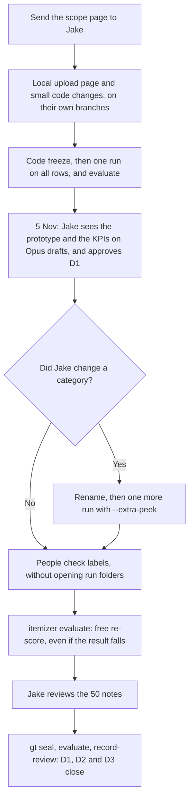

# Freight Invoice Itemization: done versus expected

*   **Author:** Drafted by Claude for Alejandro Tabares
*   **Status:** Proposed
*   **Date:** 2026-11-03

--------------------------------------------------------------------------------

## Overview

**None of the five deliverables meets its "done when" condition today.** The D3 software exists and runs on every row, but D3's three conditions are only one-third met, and the result it reports rests on labels that no person has checked.

"Expected" here means Project Scope v1.0 (1 October 2026), plus the course requirements in `architecture/docs/10-course-requirements.md`. "Done" means what is on branch `d1-d2-d3-thin-path` at commit `63f440d`, and the run on all rows from today.

| Deliverable | Due | Result today | What is missing |
|---|---|---|---|
| D1 Category list | 15 Oct, 19 days late | Not met | The team's edit and Jake's written approval |
| D2 Locked test set | 22 Oct, 12 days late | Not met | Every label is an unchecked Opus draft, and no person has labelled or reviewed anything |
| D3 Prototype | 5 Nov, 2 days away | 1 of 3 conditions | A Level 1 result on real labels, and Jake seeing it |
| D4 Final tool | 3 Dec | Mostly built, not accepted | A run on a real new export, a real Level 2 result and the D4 check |
| D5 Report | 3 Dec | Not started | The whole report |

## The Problem

Three things stand between today and the 5 November review. None of them is a coding task.

1. **The accuracy figure does not yet show accuracy.** Opus wrote all 200 labels, and the tool runs on Opus, so 99.3% mostly shows Opus agreeing with itself.
2. **Notes went to an external AI without the approval the scope requires.** The scope says this "continues only with Jake's written approval", and otherwise the team uses a local model or masks names first. All 729 notes have gone to the API, unmasked, on the team's understanding that the file is open. The notes hold 15 email addresses and at least 42 phrases that look like names. Nothing in the repo shows a request has been sent.
3. **No scope change has been agreed.** The scope says changes "are agreed in writing". Apart from the team's report that Jake approved Opus labels, the repo records no answer to any of the five changes on the scope page. The page is still private, and every entry in `deliverables/requests.yaml` shows `asked: null`.

## Goals

*   Compare each scope condition with measured evidence, one condition at a time.
*   Separate "the software can do this" from "this has been shown on real data".

## Non-Goals

*   Planning the course work or the Web UI in detail. They come after D3, and the plan only places them.
*   Judging whether the labels are right. That needs a person to read the notes.

## Deliverables, condition by condition

### D1. Charge category list

| Expected | Actual | Result |
|---|---|---|
| 12 to 20 categories | 19, plus a catch-all | Met |
| Each has a definition | All 20 do | Met |
| Each has real examples | 1 or 2 each | Met |
| About two pages | About 500 words, so closer to one page | Met, not checked as a printed page |
| Jake approves in writing | No approval is recorded, and the draft is unchanged since I wrote it | **Not met** |

I wrote this draft during a session. The `gt draft-taxonomy --send` path has never run live.

### D2. Locked test set

| Expected | Actual | Result |
|---|---|---|
| 200 distinct notes | 200 | Met |
| Half single-charge, half multi-charge or large | 103 and 97 | Met |
| About 300 charges | 279 | Met |
| Notes carry their **correct** charges | Unknown: all 200 are unchecked drafts | **Not shown** |
| Two people label 50 notes, blind to tool output | Two Opus passes, and no people. Waived, by the team's report of Jake's approval, with no written reply on file | **Waived, not yet in writing** |
| Jake or a PPG accountant reviews those 50 | No review is recorded | **Not met** |
| All disagreements resolved | Zero between the Opus passes, which is weak evidence | **Not met as written** |
| Never used to tune the tool | Held so far: only aggregate scores have been read | Met so far |

**A route I closed.** Now that TEST is frozen, `gt import-labels` refuses `label_A`, `label_B` and `label_single`. So two people cannot import blind labels for the 50 notes. The review workbook is not a substitute, because it shows Opus's label to the reader. The team reports that Jake approved Opus labels replacing the two blind labellers (Decision 2), so no route is being built. CR-5 on the scope page must say the condition is waived, and his written reply is still needed.

### D3. Prototype for review

| Expected | Actual | Result |
|---|---|---|
| Runs end to end on the sample export | 1,347 rows in 3.2 minutes | Met |
| Meets Level 1 on the test set | Numbers pass, against unchecked drafts | **Not shown** |
| Jake has seen it | No review is recorded | **Not met** |
| About 1,000 lines of Python | 4,910, plus 6,753 lines of tests | Over, and disclosed on the scope page |

### D4. Final itemization tool

| Expected | Actual | Result |
|---|---|---|
| Runs on a new export with one command | `itemizer run --export <file>` works on invented exports only. It also needs a prepared project first | **Not shown** |
| Meets Level 2 | See the next section | **Not shown** |
| Excel file with items and row summary sheets | Both, plus three more. No one has opened one in real Excel | Met, not checked in Excel |
| Under 30 minutes for 1,500 rows | 3.2 minutes for 1,347 rows, with 729 model calls | Met by projection |
| About 2,000 lines of Python | 4,910 | Over, and disclosed |

The D4 check, `itemizer acceptance d4`, does not exist. PPG's fresh month is not in `deliverables/requests.yaml`, so nothing is tracking the most likely source of a real new export.

### D5. Methodology and evaluation report

| Expected | Actual | Result |
|---|---|---|
| Every Section 3 measure, with its sample size | Figures exist in `openspec/changes/add-d3-thin-path/live-check.md`, with no report | **Not started** |
| Shows error examples | None written | **Not started** |
| An outside reader can rerun the tool from the report alone | The root `README.md` is 2 lines, with no quick start | **Not started** |
| 8 to 12 pages | 0 | **Not started** |

## Objectives

| Level | Coverage, dollars | Coverage, rows | Accuracy | Work the level includes | Actual |
|---|---|---|---|---|---|
| 1, by 5 Nov | 99.1%, target 80% | 99.0%, target 25% | 99.3%, target 95% | Single-charge rows, largest disputes, discrepancy flags | Built and run. Accuracy not yet shown |
| 2, by 3 Dec | 99.1%, target 90% | 99.0%, target 85% | 99.3%, target 95% | Multi-charge rows, rate × quantity, taxes, amounts already paid | Built, with thin evidence below |
| 3, stretch | 99.1%, target 95% | 99.0%, target 95% | 99.3%, target 95% | A standard charge code list, and a cost-driver summary | **Not built** |

**Correcting my last report: it said Levels 2 and 3 pass.** Only their numbers do. Table 1 defines each level by the work it includes, and `kpi.level_gate` checks numbers alone, so the KPI snapshot reads `pass` for Level 3 with its work unbuilt. The status page shows only Level 1, but anyone reading the snapshot would be misled.

**How much of Level 2's work has met a real note,** across all 881 items the tool produced:

| Work | Items | What that shows |
|---|---|---|
| Multi-charge notes | 111 notes | Exercised |
| Taxes | 15 | Exercised |
| Amounts already paid | 1, against 2 in the TEST labels alone | Barely exercised, and the two disagree |
| Rate × quantity | 0, in the tool and in the labels | Never used on real data, and tested only on invented notes |

Zero rate × quantity items could mean the file has no such notes, or that Opus reads them all as stated amounts. Only a person reading the notes can tell.

**Coverage is not what the scope's purpose asks.** The scope's purpose is rows "an accountant can accept without reading the note". Its definition of coverage also counts discrepancy rows, and those are flagged for the accountant to read.

| Measure | Rows | Dollars |
|---|---|---|
| Coverage, as the scope defines it | 99.0% | 99.1% |
| Verified or no charge stated, so accepted without reading | 82.1% | 50.0% |

We meet the wording, and Jake may read 99.1% as work he is spared. Half the dollars still need an accountant.

**Accuracy leaves some disagreement out.** It counts covered notes only, so 195 of 200. The tool marked 0 of 729 notes as stating no charge, while the labels mark 3 of the 200 TEST notes that way. The five uncovered notes are the likely place for those three, and I have not checked this.

## What cannot be compromised

| Expected | Actual | Result |
|---|---|---|
| Every item shows the exact words it came from | 881 of 881 items pass the check, with 0 invariant violations | Met |
| Never invents or edits an amount | The parser rejects, and nothing repairs. Limit: an amount passes if its digits are in the quoted words | Met, with a recorded limit |
| A row that does not add up is flagged | 91 rows, $30,802 | Met |

## Constraints

| Expected | Actual | Result |
|---|---|---|
| Data stays on team accounts, and is not published | Git history scanned before the push: no note text, key or data file | Met |
| External AI only with Jake's written approval | Sent without it | **Not met** |
| Fresh month requested, or results reported as in-sample | Reported as in-sample. The request is not tracked | Partly met |
| No cost to PPG | About $8 of API use, on the team's key | Met |
| About three hours of PPG time | None recorded. CR-1 puts it all around one session | Open |
| Progress tracked on the kanban board | Not checked: my token lacks `read:project` | **Unknown** |
| PPG's minutes per dispute and monthly volume, for the saving | Tracked, with no request recorded | **Not met** |

## Differences from the scope

**On the scope page, with no written answer recorded:** CR-1 present together, CR-2 web interface, CR-3 external AI, CR-4 output sheets, CR-5 Opus drafts. Q-1 to Q-4 are open as well.

**Not on the scope page, and should be:**

*   Rows that add up on a repeated invoice are marked `discrepancy`. The scope defines verified as items adding up. This covers 136 rows and $60,840, and counting them as verified would take accepted dollars from 50.0% to 82.6%. Q-2 asks about the dollar total, and not this.
*   D2's two blind labellers are waived, as described under D2.

**Built, and not asked for by the scope:**

*   At your request: the controlled grammar, the model registry and comparison, the `Largest` sheet, and the label review workflow.
*   My additions: the one-page status summary, the TEST budget ledger, and the `--extra-peek` route around it.

## Course requirements

These are internal, so Jake does not approve them, but they are still expected of the team. `architecture/docs/10-course-requirements.md` gives no dates.

| Requirement | Actual | Result |
|---|---|---|
| Agentic workflow, for the team and the client | Team workflow in use. The itemization agent moved to after D3 (ADR 0014), so D3 has no agent | Partly met |
| Pretrained model | Claude, through the API. The local adapter is untested | Met |
| At least 5 custom agentic tools | None | **Not started** |
| Skill folder with `SKILL.md` | None | **Not started** |
| Evaluation methods | Level gates, intervals and weighting. No full error metrics or agent metrics | Partly met |
| Data protection and simulated data | Scan, send gate and leak checks. No synthetic data generator | Partly met |
| Safety guardrails | The grammar and evidence checks act as an output guard. No guardrail layer | Partly met |
| With and without guardrails | None | **Not started** |
| Code demo, website demo, poster, research paper, `REFERENCES.md` | None | **Not started** |

**OpenSpec tasks:** `add-d3-thin-path` is at 23 of 25, `add-model-drafted-test-labels` is complete, and `add-ground-truth-bootstrap` is at 18 of 29. The other 21 changes are at 0 of 250 tasks. That count overstates the gap a little, because the thin path covers part of what those changes describe and nothing has been ticked there.

## The strongest counter-arguments

**"D3 is nearly done, because the software works."** It is the weakest reading. Two of D3's three conditions need people, not code: labels someone has checked, and Jake seeing it. The repo shows neither has started, and 2 days remain.

**"Show Jake the 99.3% and explain the caveat."** This is defensible only if the caveat comes first. A client who remembers one number will remember 99.3%, and the page's warning sits above a table that marks each condition as met. The scope says accuracy is measured on a locked test set that people labelled, so this result does not satisfy that condition yet, whatever the caveat says.

**"Opus's labels are probably right."** They may be. On simple notes they probably are. But nobody has measured it, and the only test available (two Opus passes agreeing on 50 of 50) cannot tell a shared mistake from a right answer. The balance-due rule is a likely shared mistake: both the labeller and the tool follow a rule that TRAIN contradicts on 33 of 51 rows.

## Open Questions

*   **Kanban board:** what does it show? I need `gh auth refresh -s read:project` to read it.
*   **5 November:** is a session with Jake booked? Nothing in the repo says so.
*   **Course dates:** when are the demos and the poster due? The agent, tools and guardrails have 0 tasks done, and the plan moved them after D3.
*   **Balance due (Q-3):** the team keeps the current rule (Decision 1), and Jake's answer is still open. If he decides otherwise, the labels, the prompt and the verified share all change.

## Technical Plan

The plan closes what can be closed by 5 November, and says what cannot. The team has chosen to show the working prototype and its measurement system at the meeting, and to correct the labels afterwards. **So every figure Jake sees on 5 November rests on unchecked Opus drafts, and the updated figures may be worse.** The page must say this first.

### Why the order matters

The D3 TEST budget is spent. Anything that changes the prompt, the category list or a result-deciding setting makes the current run out of date, and each new run then needs `--extra-peek`, which the status page flags. So every such change goes into **one** new run. Labels are different: correcting them re-scores the same run, with no model calls and no budget.

What each kind of change costs, measured on invented data and on today's run:

| Change | New run? | Model calls | TEST budget |
|---|---|---|---|
| A label only | No | None | Free |
| A setting only, such as the repeated-invoice policy | Yes | None, because answers come from the cache | `--extra-peek` |
| The prompt or the category list | Yes | All 729 notes, about $3.65 | `--extra-peek` |

### Defects to fix first

**A category rename can pass unread drafts off as checked, and I shipped this today.** After a rename, the frozen labels hold the old code. An untouched review workbook is rejected, with 250 lines failing as `unknown_category`. Find-and-replace in the workbook gets it through, but marks all 200 notes `person_corrected` and sets `corrected_after_freeze` to 200. No draft would remain, so the final seal's guard would pass with nobody having read a note. The team's D1 edit is the likely trigger, so this comes before that edit.

**`level_gate` reports `pass` for Level 3 with its work unbuilt,** as the comparison above describes.

### Changes before 5 November

| File | What changes | Why | Makes the run out of date? |
|---|---|---|---|
| New: the local upload page | Upload an Excel file, watch it run, download the output Excel, see the KPIs. It runs on the presenter's machine, with no accounts and no review pages. Details are in Detailed Implementation | The team wants to show this working at the meeting | No |
| `src/itemizer/kpi.py` | A run whose answers and result-deciding settings match one already charged counts as a re-score, whatever its code | Otherwise adding the page changes every run's identity, and the status page warns of a second peek that never happened | No |
| Scope page, ADR 0014, ADR 0011 | CR-2 says the web interface comes after D3, ADR 0014 leaves it out of D3, and the signed scope says none is built. All three change to say a local page comes first. A new ADR records this | Jake must agree in writing, and the record must match | No |
| `src/itemizer/bootstrap/labels.py`, `src/itemizer/cli.py` | New `gt rename-category <old> <new>`: changes the code in the category list, the imported labels and the frozen labels, keeps each label's `source`, and logs it. It does not count as a correction | Closes the defect above | The list changes, so yes, in the one new run |
| `src/itemizer/bootstrap/labels.py` | The review pack and its import both refuse while any current label holds a code no longer in the category list, and point to the rename command | Closes the find-and-replace route, which only exists in that state | No |
| `src/itemizer/kpi.py` | `level_gate` gets a fixed list of levels whose work exists, and reports `work_not_built` for the others, in the code and not in `config/run.yaml` | The snapshot should not say Level 3 passes | No |
| `src/itemizer/kpi.py`, `src/itemizer/acceptance.py` | Report rows and dollars accepted without reading, beside coverage | The scope's purpose is this figure, not coverage | No |
| `src/itemizer/kpi.py`, `src/itemizer/acceptance.py` | Report accuracy on person-checked labels only, with its n, and how many checked drafts people changed | The only evidence on whether Opus's labels hold up | No |
| `deliverables/requests.yaml` | Add PPG's fresh month, and record dates as requests go out | Nothing tracks the likeliest source of a new export | No |
| Scope page | Add the repeated-invoice row, say what CR-5 does to D2's blind labellers, and share it | Jake cannot agree to what is not listed or cannot be opened | No |
| `deliverables/reviewing_test_labels.md` | Add the rename step, and warn against find-and-replace | The instruction file currently has no route for this | No |
| `README.md` | A quick start, with links to the docs | Two lines today. The repo is also graded, and D5 needs a rerun guide | No |

Tests go with each code change, on invented notes. Each change goes on its own branch through the clean-export check, and any new behaviour goes in the OpenSpec change first.

### Checking labels after the meeting

The workbook puts the 12 doubtful notes first, then 47 large disputes, then 45 with several charges, then 96 others. If people stop partway, the result stays honest only if the page says how many were checked, and the first groups are chosen for risk, so their correction rate overstates the error rate of the rest. Checking a stretch of the last group as well gives a fairer estimate, because that group is ordered by note id, which is a hash of the text.

### After 5 November, for D4 and D5

| Gap | Change |
|---|---|
| A new export cannot run without the original dataset file. I confirmed this: the run stops with `dataset file not found`, because worked examples and category quotes read their text from it | A setup command that saves the built prompt and category list under `data/`, so a run on another export needs only those |
| No D4 check | `itemizer acceptance d4`, from `add-delivery-acceptance` |
| Rate × quantity has never met a real note | People search the notes for rates during the label check, then either the rule is fixed or the file is recorded as having none |
| No one has opened a workbook in Excel | A person opens one, and any defect becomes a test |
| No D5 report | Write it from KPI snapshots and `live-check.md`, with error examples from TRAIN only, since TEST stays aggregates only |
| Course requirements and the Web UI | Agent, tools, guardrails, skill folder, ablation and demos, in the build order in `architecture/docs/07-traceability.md`. They need a date check, because the course dates are unknown |

### Decisions the owner must make

Each has more than one defensible answer. The options are listed in no order of preference.

**Decision 5: how upload works at the meeting. Decided: a local upload page,** on the presenter's machine. A command-line demo and a hosted page were the other options.

**Decision 1: a balance due beside listed charges. Decided: keep the current rule.** Q-3 stays on the scope page for Jake. 19 of the 200 TEST notes are this case. On TRAIN, 33 of 51 such rows add up only with the balance added, and 16 add up without it.

| Option | How it works | Trade-off | Fails when |
|---|---|---|---|
| Keep the current rule | The balance is a total, and never an item | No code or new run. Flags most of these rows, with a difference equal to the stated balance | Jake expects balances as charges, which his own Sheet1 suggests |
| A separate line, counted only if it makes the row add up | The model records the balance on its own line. A fixed rule counts it only when that reaches the disputed amount | Settles 49 of the 51 TRAIN rows. Needs a grammar change, a new run, and those 19 labels changed | A row adds up by coincidence, and is verified when it should be flagged |
| Always an item | The balance is always a charge line | Simple, and needs a new run and the labels changed | The balance is the total, as on 16 of the 51 rows, which then get flagged wrongly |

**Decision 2: D2's two blind labellers. Decided: waived.** The team reports that Jake approved Opus labels replacing the two blind labellers. The team still checks the labels and Jake still reviews the 50. His written reply is still needed as evidence, and the repo does not hold it yet.

| Option | How it works | Trade-off | Fails when |
|---|---|---|---|
| Ask Jake to waive it in CR-5 | People check Opus's labels, and Jake reviews the 50 | No code, and it is the fastest | Jake refuses. A reader of an existing label also tends to accept it |
| Two people label the 50 notes blind | They use the blank packs, which still exist, and a new command imports them and compares them with the frozen labels | Meets the scope's wording, and gives the first real measure of Opus against people. Needs code, and 2 people for part of 2 days | There is not enough time before 5 November |
| Do it after 5 November | Waive it for the review, and do the second option before D4 | The review goes ahead, and the gap closes later | The team runs out of time in December, or tool output has been seen by then |

**Decision 3: repeated invoices that add up. Decided: keep them as `discrepancy`.** This departs from the scope's definition of verified, so it goes on the scope page. 136 rows and $60,840.

| Option | How it works | Trade-off | Fails when |
|---|---|---|---|
| Keep marking them `discrepancy` | The current setting | Protects against paying twice. Accepted dollars stay at 50.0% | Jake wants the scope's definition of verified |
| Mark them `verified`, and keep the `repeated` column | Set `review.repeated_invoice_policy: none`. No model calls | Accepted dollars rise to 82.6%, and it matches the scope's wording | An accountant filters on `verified` and pays a repeat |

**Decision 4: what Jake sees on 5 November. Decided: all figures, with the caveat first,** and updated results after the labels are corrected, even if they are worse.

| Option | How it works | Trade-off | Fails when |
|---|---|---|---|
| All figures, with the caveat first | The status page as it stands, opening with who wrote the labels | He sees everything | He remembers 99.3% and not the caveat |
| Coverage and accepted-without-reading only, with accuracy held back until people finish | The page leaves accuracy out until a set number of labels are checked | Nothing misleading can be repeated | He asks whether Level 1 is met, and the honest answer is not yet |
| Accuracy on person-checked labels only | The page shows accuracy with its n, from checked notes | The only figure that is real evidence | Few labels are checked, so the range is wide and the sample leans to risky notes |

## Alternatives Considered

No brainstorm file exists for this work, so these come from the ADRs and from decisions made in this session. "Rejected by" says who decided, so a choice I made is not mistaken for one you made.

### Rejected

| Alternative | Rejected by | Why |
|---|---|---|
| Build the full plan for D3: agent, guardrails, Web UI and registries | ADR 0014, after you chose to present D1, D2 and D3 together | It could not be built by 5 November. The cost is that D3 has no agent, so the course requirements still need one |
| People label all 200 TEST notes before the first run | You, today | There was no time, and you asked for Opus to draft them. The cost is that accuracy is not yet evidence |
| A Streamlit interface | You | You wanted plain HTML, which is easier to manage and deploy (ADR 0011) |
| Reading TEST notes in this session and writing labels by hand | Me | It would put TEST text in the developer's context, and could not be repeated or costed. The API route avoids both |
| Find-and-replace in the review workbook to handle a rename | Me, in this plan | It marks unread drafts as `person_corrected`, and so defeats the final seal's guard |
| Marking which levels are built in `config/run.yaml` | Me, in this plan | That file decides the run's identity, so the change would make today's run out of date for no change in any answer. A list in the code does not |
| Deleting the freeze files by hand to let people import labels | Me | It would remove the record of what was frozen and when. If Decision 2 needs a route, it should be a command that logs what it did |
| Pushing straight to `origin/main` | Me, today | The repo takes changes through PRs (PR #6 went that way), so I published a named branch |

### Not yet weighed

These have not been put to you, so they are not rejected. Both change the plan if they turn out to be the right call.

**Asking Jake to move the D3 review.** The plan assumes 5 November holds. D1 and D2 are already 19 and 12 days late, and the scope's final delivery is not until 3 December. A review a few days later could show accuracy on labels people have checked, rather than a caveat. The counter-argument is that the scope makes 5 November the minimum commitment, and asking again may cost more trust than a provisional figure. CR-1 already asks him to accept one schedule change.

**What happens if Jake refuses external AI (CR-3).** The plan assumes he agrees, but the scope's stated alternative is a local model or masked names. All of today's results came from Opus, so a refusal means a new run on another model, and new labels too if the drafts must also come from that model. The Ollama adapter has never run against a real server, and masking is not built. So the fallback the scope promises does not exist today, and the plan has no time set aside for it.

## Detailed Implementation

Every code change goes on its own branch from `main`, through the clean-export check, and merges with `--no-ff`. New behaviour goes in OpenSpec before the code. The branches below are in order, and each lists every file it touches.

**The cut line.** If the page is not working by the evening of 4 November, the meeting uses the command-line demo, which needs no code. Branches 1 to 3 go ahead either way, and those three alone would be enough for the status page to be honest.

### Branch 1: `docs/local-upload-plan`

| File | Change | Why |
|---|---|---|
| `openspec/changes/add-local-upload-page/` (new: `proposal.md`, `design.md`, `tasks.md`, `specs/local-upload-page/spec.md`) | A new change, with the routes and rules below | A subset of `add-web-ui` with no login, so that change's 31 tasks are not left half-ticked |
| `openspec/changes/add-web-ui/proposal.md` | Note that the local page comes first and is absorbed later | Keeps the two changes from drifting apart |
| `openspec/changes/add-d3-thin-path/specs/level-evaluation/spec.md` | Add the requirements for `work_not_built`, accepted without reading, accuracy on checked labels, and the re-score rule | These change what a Level result means |
| `openspec/changes/add-d3-thin-path/specs/d3-presentation/spec.md` | The caveat comes first on the page, and the new figures are shown | Decision 4 |
| `openspec/changes/add-model-drafted-test-labels/specs/test-label-review/spec.md`, `tasks.md` | Add `gt rename-category`, and the refusal while labels hold an old code | Closes the defect |
| `architecture/adrs/0016-local-upload-page-before-d3.md` (new) | Records the choice of a local page, with the command-line and hosted options as alternatives | The signed scope says no interface, so the reason must be on record |
| `architecture/adrs/0014-d3-thin-path-controlled-grammar-model-registry.md`, `0011-plain-html-ui-with-thin-server.md` | Status lines point to ADR 0016. ADR 0011 notes that login waits for the full UI | They currently say the opposite |
| `architecture/README.md` | ADR range 0001 to 0016, and 25 changes | Keeps the count accurate |
| `architecture/docs/01-overview.md`, `07-traceability.md` | D3's row and the build order include the local page | Same reason |
| `architecture/docs/11-data-contracts.md` | `data/uploads/`, `work_not_built`, and the new KPI fields | This doc lists every contract |

### Branch 2: `fix/category-rename`

| File | Change | Why |
|---|---|---|
| `src/itemizer/bootstrap/labels.py` | New `rename_category(ws, old, new, merge)`. It changes the code in `labels/label_A.json`, `label_B.json`, `label_single.json`, `label_replacements.json`, `test_label_review.json`, `client_review.json` and `test_provisional.json`, updates the frozen record's hash, keeps each label's `source`, and adds a line to `labels/category_renames.jsonl`. It refuses after the final seal. `write_label_review` and `import_label_review` refuse while a current label holds a code outside the list | Closes the defect |
| `src/itemizer/bootstrap/taxonomy.py` | New `rename_in_taxonomy(path, old, new, merge)`. It refuses the catch-all, a missing `old`, or an existing `new` unless `merge` is set, and merging removes `old` | A rename changes the list too, and an earlier approval then stops applying, as it should |
| `src/itemizer/cli.py` | New `gt rename-category <old> <new> [--merge]`, printing counts only | The supported route |
| `tests/test_label_review.py` | A rename keeps every `source` and leaves `corrected_after_freeze` unchanged. A merge works. Both refusals work. A hand-edited list blocks the pack and the import. The final seal still refuses drafts after a rename | Each scenario, including the defect itself |
| `deliverables/reviewing_test_labels.md` | Add the rename step, warn against find-and-replace, and note what the meeting exposes | The file has no route for this today |

### Branch 3: `fix/level-gate-and-measures`

| File | Change | Why |
|---|---|---|
| `src/itemizer/kpi.py` | `level_gate` gets a fixed `LEVELS_WITH_WORK_BUILT = (level1, level2)`, and any other level reports status `work_not_built` | Level 3 must not read `pass` |
| `src/itemizer/kpi.py` | `coverage` adds `accepted_without_reading`, for rows and dollars, counting `verified` and `no_charge_stated` | The scope's purpose. 82.1% of rows and 50.0% of dollars today |
| `src/itemizer/kpi.py` | `evaluate` adds `accuracy_on_checked_labels` (covered notes with a person's label, with correct, n and Wilson interval, unweighted) and `labels_changed_by_people` | The only figures that are real evidence. Unweighted, because the checked notes are not a random sample |
| `src/itemizer/kpi.py` | The budget ledger keys a charge on the digest of the answers plus the prompt, category list and settings hashes, and no longer on the run id. Matching all of them is a `rescored` | Adding the page changes the code hash and so every run id. The answers would be identical, so no new peek happens, and the page should not warn of one |
| `src/itemizer/acceptance.py` | The caveat moves to the top of the page. Adds an accepted-without-reading table and accuracy on checked labels when n is above 0 | Decision 4 |
| `tests/test_kpi.py` | The code-only case is now a `rescored`. Different answers are still refused. Hand-worked numbers for each new figure | `test_second_run_is_refused_before_anything_is_written` changes, because it builds its second run by changing only the code hash |
| `tests/test_acceptance.py` | The caveat comes before D1 on the page, and the new figures appear | Decision 4 |
| `tests/test_pipeline.py` | A code-only change gives a new run id and a free re-score | The end-to-end path the meeting depends on |

### Branch 4: `feature/local-upload-page`

**Routes.** All pages are server-rendered with Jinja2 autoescaping, as ADR 0011 specifies. They call the same functions as the command line, and hold no business logic.

| Route | What it does |
|---|---|
| `GET /` | The upload form, and recent runs: file, outcomes, date |
| `POST /uploads` | Accepts `.xlsx` up to 25 MB, read in chunks and refused past the limit. Stores it as `data/uploads/<sha256>.xlsx`, so a file name never reaches a path. Redirects to the pre-check |
| `GET /uploads/<sha256>` | Pre-check: columns, rows, distinct notes, any stop from the scan or from held-back notes, and how many notes need new model calls with an estimated cost. Says whether the file gets full KPIs. The start button is disabled on any stop |
| `POST /uploads/<sha256>/run` | Starts `pipeline.run` on a background thread. Refuses a second job while one is running |
| `GET /jobs/<id>`, `GET /jobs/<id>/status` | A page, and the JSON it polls in plain JavaScript: state, notes done and total, elapsed time, cost so far, and a plain message on failure |
| `GET /runs/<run_id>` | Outcomes, coverage, accepted without reading, a download button, and a score button for a run on all rows of the dataset file |
| `POST /runs/<run_id>/evaluate` | Calls `pipeline.evaluate_run`, and shows any refusal as a message. `--extra-peek` stays on the command line, because it should not be one click |
| `GET /runs/<run_id>/download` | Sends `itemized.xlsx`, with the run id checked against its pattern first |
| `GET /status` | Runs `acceptance.d3_check` and shows the page |

**Safety rules.**

*   The server binds to `127.0.0.1` only, with no `--host` option, because it has no login.
*   Every request must carry a local `Host`. Every `POST` must carry a local `Origin`, so a web page open in the same browser cannot start a paid run.
*   Errors follow the command line's rule: a `ContractError` shows its message, and anything else shows its type only.
*   The page warns that the download holds tool output on TEST notes, and is not for someone about to check labels.

| File | Change | Why |
|---|---|---|
| `src/itemizer/ui/__init__.py`, `app.py`, `jobs.py` (new) | The FastAPI app with the routes above, and a single-job runner with a lock | The page itself |
| `src/itemizer/ui/templates/base.html`, `home.html`, `precheck.html`, `job.html`, `run.html` (new) | Plain HTML forms, with a small polling script in `job.html` | ADR 0011 |
| `src/itemizer/itemize.py` | `itemize_notes` takes an optional `progress(done, total, spent)` callback | Telemetry is only written at the end, so nothing else can show progress |
| `src/itemizer/pipeline.py` | `run` passes `progress` through. New `inspect_export(root, path)` returns the pre-check's facts, using the same rules as `run`, so they cannot disagree | The pre-check must say what the run would do |
| `src/itemizer/cli.py` | New `itemizer ui [--port]` | ADR 0011 names this command |
| `pyproject.toml`, `uv.lock` | Extra `ui`: `fastapi`, `jinja2`, `python-multipart`, `uvicorn`. The dev group adds `httpx`, plus the `ui` packages so tests can run | None is installed today |
| `tests/test_ui.py` (new) | With a fake model and no network: upload, pre-check, run, download, score. A wrong type and an oversized file. A missing column disables the start button. A second job is refused. A bad run id. A foreign `Origin` is refused. Nothing from a note reaches an error page | One test per scenario in the new spec |
| `tests/test_itemize.py` | `progress` is called once per note, and a failure inside it does not stop the run | Progress must not be able to break a run |

### Branch 5: `chore/before-the-meeting`

| File | Change | Why |
|---|---|---|
| `deliverables/requests.yaml` | Add PPG's fresh month and Jake's written reply on Opus labels. Record dates as requests go out | Both are untracked |
| `deliverables/meeting_2026-11-05.md` (new) | The order of the demo, what to say first, the rehearsal below, and the fallback to the command line | The plan needs to be usable without this conversation |
| `README.md` | What the project is, install, a quick start, links to the docs | Two lines today |
| `openspec/changes/add-d3-thin-path/live-check.md` | The new run's figures | Keeps the record current |

**Not in the repo:** the scope page. CR-2 changes to say a local page comes before D3. CR-5 states that the two blind labellers are waived. It adds the repeated-invoice row, and the D3 summary's accepted-without-reading figures. You then share it, because Jake cannot open it until you do.

**Files that deliberately do not change.**

*   `config/run.yaml`: a `ui` section would change the settings hash and make the run out of date. The page's limits are constants until `add-configuration-registry`.
*   `taxonomy/categories.yaml` and `prompts/`: unchanged before the meeting, so no new model calls are needed. This assumes the team does not edit D1 first. If it does, the run costs about $3.65 and needs `--extra-peek`.
*   `architecture/workspace.dsl`: the Web UI container already covers this.

### Rehearsal, on the real data, before the meeting

Each step is a check that must pass, and any failure is fixed or moves the demo to the fallback.

1.  `itemizer run` from a clean commit, then `itemizer evaluate`. The ledger reads `rescored`, and the page carries no extra-peek warning.
2.  Upload the AutoPay file through the page, **with the network off**. It must finish from the cache, make no model calls, and give the same workbook hash as step 1.
3.  Open the downloaded workbook **in real Excel**, which no one has done yet.
4.  Read the status page as Jake would. The caveat comes first, and the figures match `live-check.md`.
5.  Upload a small file of invented notes with the network on, and confirm the progress, the output, and that no accuracy is shown.
6.  Correct one label through the review workbook, re-score, confirm the figure changes, then **undo that correction by correcting it back**. This changes a frozen label, so the rehearsal must use a copy of `data/`.

### Risks left in this plan

| Risk | What happens | Mitigation |
|---|---|---|
| A new real file holds an email or a name | The scan stops it before any call, and the page shows a count | Expected behaviour. Say so in the demo, and use the AutoPay file |
| The team sees tool answers on TEST notes at the meeting | They could follow them when checking labels afterwards | Small, because the review workbook already shows Opus's label and the two agree on 192 of 195 covered notes. Reviewers still judge from the note, and those few disagreements matter most |
| An outage during a new-file upload | Notes go to Review, and the page shows the reason | The AutoPay file comes from the cache, and works offline |
| The page only runs on the presenter's machine | Jake cannot try it himself | Accepted in Decision 5 |
| Jake refuses external AI at the meeting | Today's results stop being usable, and the fallback does not exist | Ask for CR-3 before the meeting, not during it |

